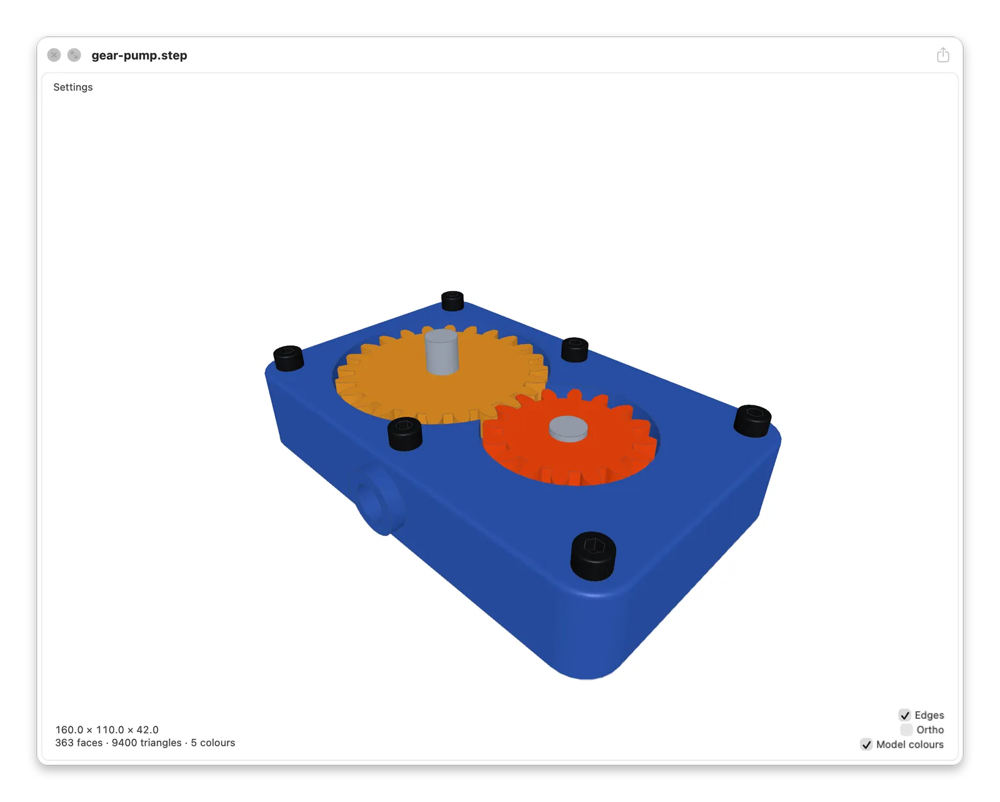
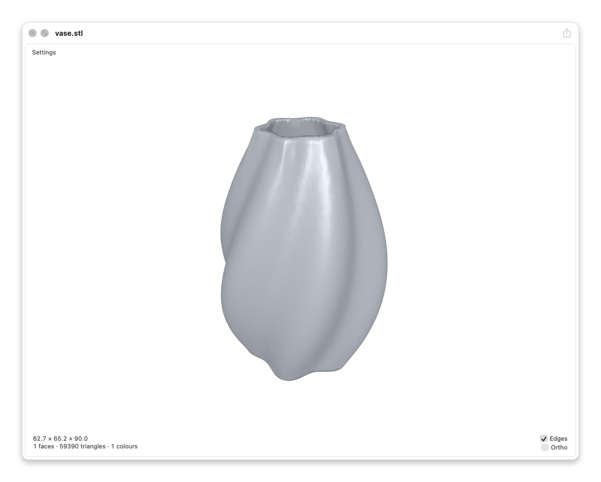
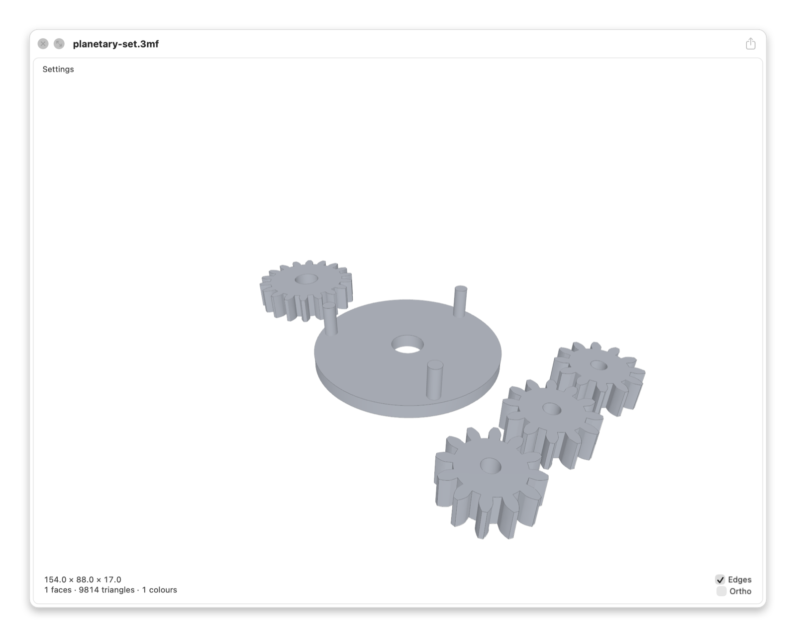
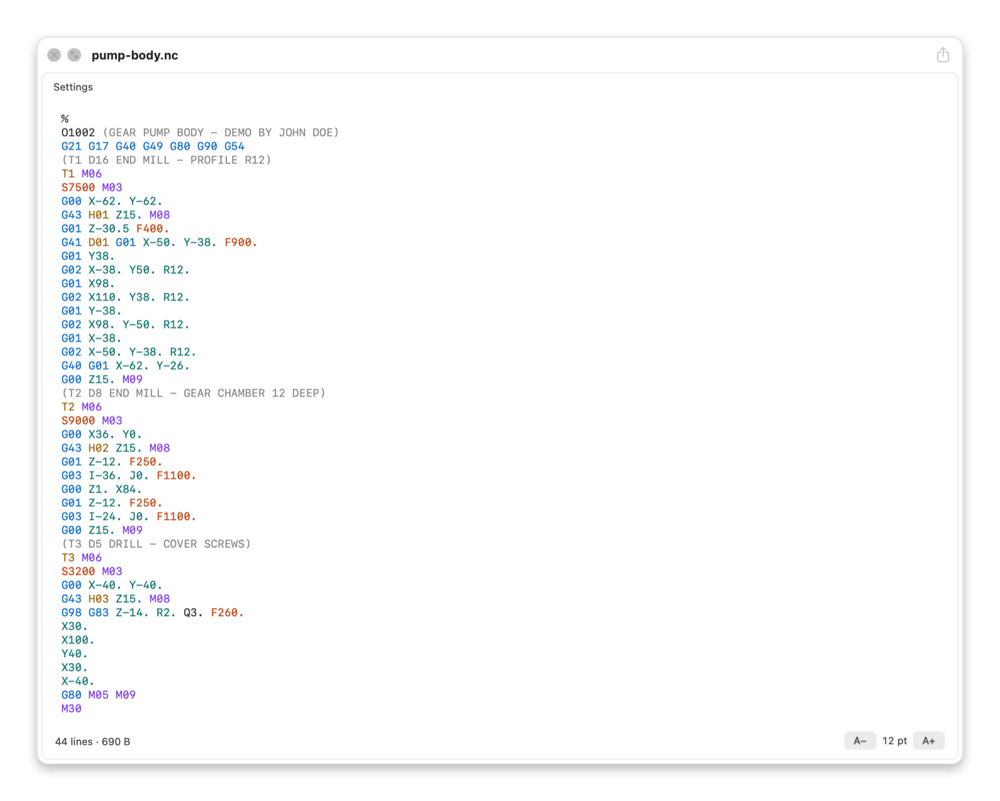
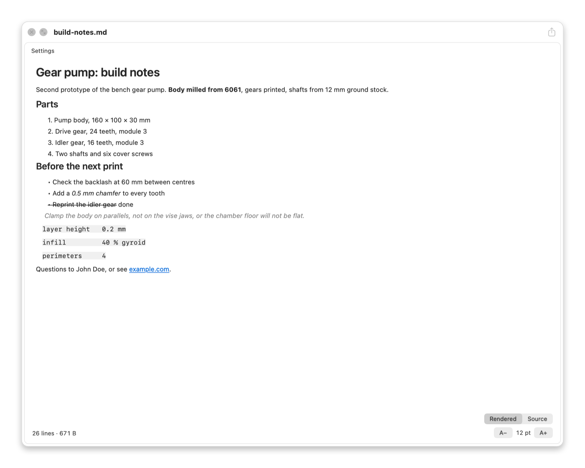
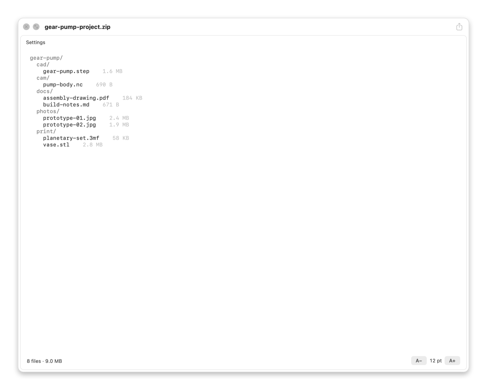
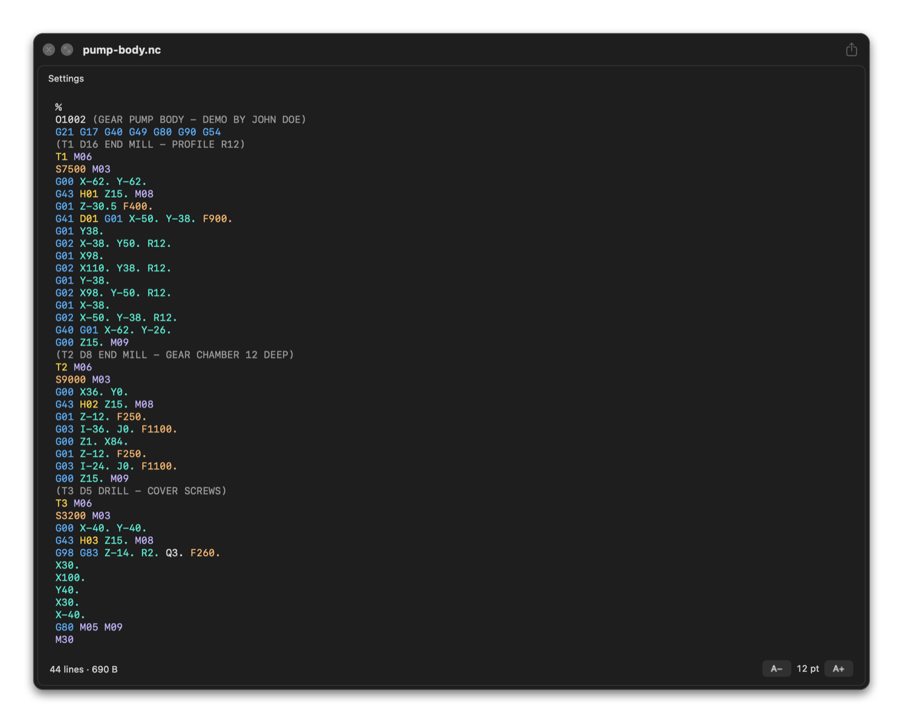

# Mac CAD Preview

Press Space in the Finder to preview CAD models, G-code, Markdown and archives.

Apple Silicon · macOS 12 or later. A fork of [Justin Brouillette's original app](https://github.com/jbrewlet/mac-cad-preview).

<picture>
  <source media="(prefers-reduced-motion: reduce) and (prefers-color-scheme: dark)" srcset="docs/screenshots/demo-still-dark.png">
  <source media="(prefers-reduced-motion: reduce)" srcset="docs/screenshots/demo-still-light.png">
  <source media="(prefers-color-scheme: dark)" srcset="docs/screenshots/demo-dark.webp">
  
</picture>

The animation and screenshots are rendered from generated demo files by [`scripts/screenshots.sh`](scripts/screenshots.sh).

## Download

| System | Download 0.4.1 | First launch |
| --- | --- | --- |
| macOS 12+ · Apple Silicon | [DMG](https://github.com/tmanaud/mac-cad-preview/releases/download/v0.4.1/MacCADPreview-0.4.1.dmg) | Drag the app to Applications. Not notarised: open it once, then choose **Open Anyway** in System Settings → Privacy & Security. |

Opening the app once registers the extension. You can then quit it.
[All releases and checksums](https://github.com/tmanaud/mac-cad-preview/releases).

## Formats

| Format | Extensions | Preview |
| --- | --- | --- |
| STEP / IGES | `.step` `.stp` `.p21` / `.iges` `.igs` | Interactive 3D with model colours |
| STL / 3MF | `.stl` / `.3mf` | 3D; basic mesh support for 3MF |
| G-code | `.nc` `.tap` | Syntax-highlighted text |
| Markdown | `.md` `.markdown` | Rendered document or source |
| Archives | `.zip` `.rar` `.7z` | File listing; nothing extracted |

## Use

1. Select a file in the Finder and press **Space**.
2. Drag to orbit, scroll to zoom towards the pointer, or use a two-finger or right-button drag to pan.
3. Toggle **Edges**, **Ortho** or **Model colours** (multi-colour models only). Click the dimensions to copy them.

**Settings** opens the app's settings. **Fusion** opens STEP/IGES files in Autodesk Fusion when it is installed.
**A− / A+** change text size; **Rendered / Source** switches the Markdown view.
The first preview of a big model can take seconds; later previews are instant while the result is cached.

## Screenshots

| STL vase | 3MF print plate |
| --- | --- |
|  |  |

| G-code | Markdown, rendered |
| --- | --- |
|  |  |

| Zip listing | Dark appearance, G-code |
| --- | --- |
|  |  |

[Controls, settings, troubleshooting and technical details](docs/DETAILS.md).

## Build

Needs Command Line Tools and [Homebrew](https://brew.sh).

```bash
git clone https://github.com/tmanaud/mac-cad-preview.git
cd mac-cad-preview
brew install opencascade
./build.sh
```

Copy the resulting `build/Mac CAD Preview.app` to Applications and open it once. A locally built copy is never quarantined.
Preview the [STEP test model](tests/spike.step) from Terminal with `qlmanage -p tests/spike.step`.
[`install.sh`](install.sh) does all of this in one step, from the newest release. [`package.sh`](package.sh) makes the DMG; [`scripts/screenshots.sh`](scripts/screenshots.sh) renders the pictures and also needs ffmpeg.

## Uninstall

```bash
rm -rf "/Applications/Mac CAD Preview.app"
rm -rf ~/Library/Containers/com.maccadpreview.quicklook
```

## Credits

Original app by [Justin Brouillette (jbrewlet)](https://github.com/jbrewlet/mac-cad-preview). [Buy him a coffee](https://buymeacoffee.com/jbrw).
This fork fixes crashes and memory corruption from hostile 3MF, zip and Markdown files, also offered upstream in [security fix PR #3](https://github.com/jbrewlet/mac-cad-preview/pull/3), [security fix PR #4](https://github.com/jbrewlet/mac-cad-preview/pull/4) and [security fix PR #5](https://github.com/jbrewlet/mac-cad-preview/pull/5).
MIT licence, see [LICENSE](LICENSE). [OpenCASCADE](https://dev.opencascade.org) is bundled under LGPL-2.1 with its exception; see [third-party licences](docs/DETAILS.md#third-party-licences).

This fork's changes were made with AI coding assistants (Claude, with the README redesigned by GPT), directed by the fork's maintainer.
